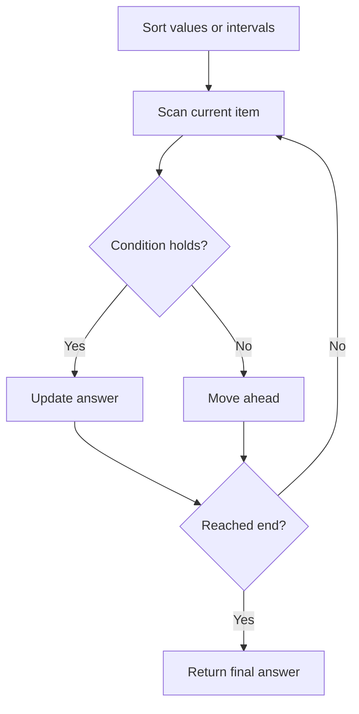

# Longest Consecutive Sequence

## Category
- Arrays

## Problem Summary
You must write an algorithm that runs in O(n) time.

## Files
- solution.cpp

## Approach
Use array scanning and counting patterns, keeping track of state while minimizing redundant passes.

## Solution Trace
1. Analyze the input and identify the key invariant or constraint the solution must maintain.
2. Transform the problem into a compact state representation that makes the decision easy to evaluate.
3. Apply the selected algorithm and update the answer as the scan progresses.
4. Validate the result against special cases such as empty input, duplicates, boundaries, and single-element cases.

## Code Trace
1. `The input is sorted or normalized before the main logic so comparisons are consistent and adjacent states are easy to reason about.`
2. `The algorithm scans the sorted values or merged intervals and updates the answer as soon as the condition is satisfied.`
3. `When the scan reaches the end, the maintained state already contains the correct final result.`
4. `The result is returned in the required order and format.`

## Code Walkthrough
- The input is sorted or normalized before the main logic so comparisons are consistent and adjacent states are easy to reason about.
- The algorithm scans the sorted values or merged intervals and updates the answer as soon as the condition is satisfied.
- When the scan reaches the end, the maintained state already contains the correct final result.
- The result is returned in the required order and format.

## Mermaid Diagram

## Algorithm
1. Read the problem constraints and identify the correct state to track.
2. Choose the most fitting pattern for the data structure involved.
3. Process the collection or graph in a single pass where possible.
4. Maintain the answer and verify correctness against edge cases.
5. Return the final value or structure after the traversal is complete.

## Complexity Analysis
- Time Complexity: O(n) or O(n log n), depending on the exact operation pattern used in the solution.
- Space Complexity: O(n) or O(1) auxiliary space, based on the chosen data structure and recursion/stack usage.

## Core Intuition
The solution reduces the problem to a smaller, trackable state and then uses the correct structural pattern to process the input efficiently. This keeps the implementation both easy to follow and correct for the constraints.

## Edge Cases
- Empty input or single-element input
- Duplicate values or repeated edges
- Boundary values and extreme indices
- Already-sorted or reverse-sorted scenarios
- Cycles, null nodes, or disconnected components when relevant

## Folder
- 009-longest-consecutive-sequence
