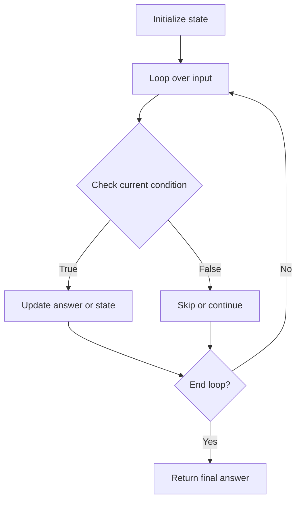

# Best Time to Buy and Sell Stock

## Category
- Sliding Window

## Problem Summary
You are given an array prices where prices[i] is the price of a given stock on the ith day. You want to maximize your profit by choosing a single day to buy one stock and choosing a different day in the future to sell that stock. Return the maximum profit you can achieve from this transaction. If you cannot achieve any profit, return 0.

## Files
- solution.cpp

## Approach
Maintain a dynamic window and update counts as the window expands or shrinks to stay efficient.

## Solution Trace
1. Convert the problem into a window over the input.
2. Expand the right boundary while the window remains valid.
3. Shrink the left boundary only when constraints are violated.
4. Track the answer as the window updates to keep the logic linear.

## Code Trace
1. `The implementation reads the input and transforms it into a compact state that matches the constraints of the problem.`
2. `The main loop checks the current item or node against the required condition before updating the answer.`
3. `Each branch and guard keeps the algorithm safe for edge cases and prevents redundant work.`
4. `After the scan completes, the collected state is returned as the final answer.`

## Code Walkthrough
- The implementation reads the input and transforms it into a compact state that matches the constraints of the problem.
- The main loop checks the current item or node against the required condition before updating the answer.
- Each branch and guard keeps the algorithm safe for edge cases and prevents redundant work.
- After the scan completes, the collected state is returned as the final answer.

## Mermaid Diagram

## Algorithm
1. Read the problem constraints and identify the correct state to track.
2. Choose the most fitting pattern for the data structure involved.
3. Process the collection or graph in a single pass where possible.
4. Maintain the answer and verify correctness against edge cases.
5. Return the final value or structure after the traversal is complete.

## Complexity Analysis
- Time Complexity: O(n) or O(n log n), depending on the exact operation pattern used in the solution.
- Space Complexity: O(n) or O(1) auxiliary space, based on the chosen data structure and recursion/stack usage.

## Core Intuition
The solution reduces the problem to a smaller, trackable state and then uses the correct structural pattern to process the input efficiently. This keeps the implementation both easy to follow and correct for the constraints.

## Edge Cases
- Empty input or single-element input
- Duplicate values or repeated edges
- Boundary values and extreme indices
- Already-sorted or reverse-sorted scenarios
- Cycles, null nodes, or disconnected components when relevant

## Folder
- 01.best-time-to-buy-and-sell-stocks
