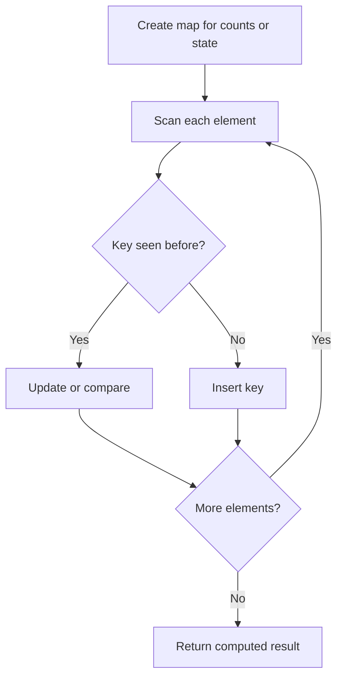

# Longest Substring Without Repeating Characters

## Category
- Sliding Window

## Problem Summary
Given a string s, find the length of the longest substring without duplicate characters.

## Files
- solution.cpp

## Approach
Maintain a dynamic window and update counts as the window expands or shrinks to stay efficient.

## Solution Trace
1. Convert the problem into a window over the input.
2. Expand the right boundary while the window remains valid.
3. Shrink the left boundary only when constraints are violated.
4. Track the answer as the window updates to keep the logic linear.

## Code Trace
1. `A hash map stores counts, indices, or state information keyed by the processed value.`
2. `As the scan continues, the map reveals whether a value has already appeared or if a state must be updated.`
3. `The current element is compared against the map to decide whether the operation should continue or terminate.`
4. `The final result is computed from the map state after the full pass is complete.`

## Code Walkthrough
- A hash map stores counts, indices, or state information keyed by the processed value.
- As the scan continues, the map reveals whether a value has already appeared or if a state must be updated.
- The current element is compared against the map to decide whether the operation should continue or terminate.
- The final result is computed from the map state after the full pass is complete.

## Mermaid Diagram

## Algorithm
1. Read the problem constraints and identify the correct state to track.
2. Choose the most fitting pattern for the data structure involved.
3. Process the collection or graph in a single pass where possible.
4. Maintain the answer and verify correctness against edge cases.
5. Return the final value or structure after the traversal is complete.

## Complexity Analysis
- Time Complexity: O(n) or O(n log n), depending on the exact operation pattern used in the solution.
- Space Complexity: O(n) or O(1) auxiliary space, based on the chosen data structure and recursion/stack usage.

## Core Intuition
The solution reduces the problem to a smaller, trackable state and then uses the correct structural pattern to process the input efficiently. This keeps the implementation both easy to follow and correct for the constraints.

## Edge Cases
- Empty input or single-element input
- Duplicate values or repeated edges
- Boundary values and extreme indices
- Already-sorted or reverse-sorted scenarios
- Cycles, null nodes, or disconnected components when relevant

## Folder
- 02.longest-substring-without-repeating-substring
