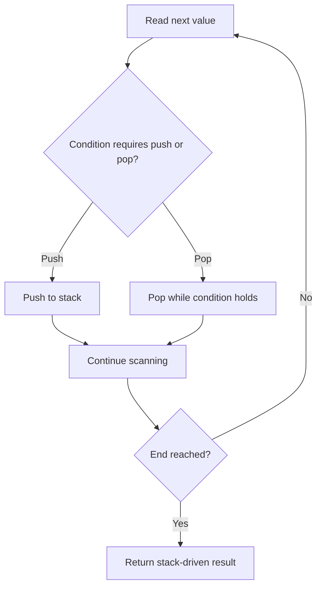

# Sliding Window Maximum

## Category
- Sliding Window

## Problem Summary
You are given an array of integers nums, there is a sliding window of size k which is moving from the very left of the array to the very right. You can only see the k numbers in the window. Each time the sliding window moves right by one position. Return the max sliding window.

## Files
- solution.cpp

## Approach
Maintain a dynamic window and update counts as the window expands or shrinks to stay efficient.

## Solution Trace
1. Convert the problem into a window over the input.
2. Expand the right boundary while the window remains valid.
3. Shrink the left boundary only when constraints are violated.
4. Track the answer as the window updates to keep the logic linear.

## Code Trace
1. `The right pointer expands the current window while the constraints remain satisfied.`
2. `The left pointer shrinks the window only when the current state violates the condition, restoring a valid window.`
3. `The answer is updated each time a better window is found.`
4. `The loop finishes with the best valid window recorded in the answer.`

## Code Walkthrough
- The right pointer expands the current window while the constraints remain satisfied.
- The left pointer shrinks the window only when the current state violates the condition, restoring a valid window.
- The answer is updated each time a better window is found.
- The loop finishes with the best valid window recorded in the answer.

## Mermaid Diagram

## Algorithm
1. Read the problem constraints and identify the correct state to track.
2. Choose the most fitting pattern for the data structure involved.
3. Process the collection or graph in a single pass where possible.
4. Maintain the answer and verify correctness against edge cases.
5. Return the final value or structure after the traversal is complete.

## Complexity Analysis
- Time Complexity: O(n) or O(n log n), depending on the exact operation pattern used in the solution.
- Space Complexity: O(n) or O(1) auxiliary space, based on the chosen data structure and recursion/stack usage.

## Core Intuition
The solution reduces the problem to a smaller, trackable state and then uses the correct structural pattern to process the input efficiently. This keeps the implementation both easy to follow and correct for the constraints.

## Edge Cases
- Empty input or single-element input
- Duplicate values or repeated edges
- Boundary values and extreme indices
- Already-sorted or reverse-sorted scenarios
- Cycles, null nodes, or disconnected components when relevant

## Folder
- 06.sliding-window-max
