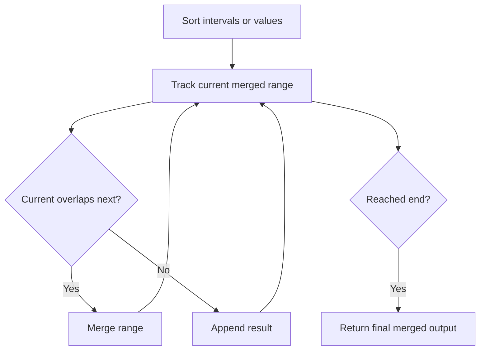

# Car Fleet

## Category
- Stack

## Problem Summary
There are n cars at given miles away from the starting mile 0, traveling to reach the mile target. You are given two integer arrays position and speed, both of length n, where position[i] is the starting mile of the ith car and speed[i] is the speed of the ith car in miles per hour. A car cannot pass another car, but it can catch up and then travel next to it at the speed of the slower car.

## Files
- solution.cpp

## Approach
Use stack-based state tracking to handle order-sensitive operations and nested structure problems.

## Solution Trace
1. Analyze the input and identify the key invariant or constraint the solution must maintain.
2. Transform the problem into a compact state representation that makes the decision easy to evaluate.
3. Apply the selected algorithm and update the answer as the scan progresses.
4. Validate the result against special cases such as empty input, duplicates, boundaries, and single-element cases.

## Code Trace
1. `If the value is new, it is inserted into the tracking structure so it can be compared later in the scan.`
2. `The main loop walks through the input one element at a time and applies the decision logic to every position.`
3. `Sorting normalizes the structure of the input so adjacent values or intervals can be compared in a predictable order.`
4. `The stack or deque preserves the order of pending work so the algorithm can revisit states in the correct sequence.`

## Code Walkthrough
- If the value is new, it is inserted into the tracking structure so it can be compared later in the scan.
- The main loop walks through the input one element at a time and applies the decision logic to every position.
- Sorting normalizes the structure of the input so adjacent values or intervals can be compared in a predictable order.
- The stack or deque preserves the order of pending work so the algorithm can revisit states in the correct sequence.

## Mermaid Diagram

## Algorithm
1. Read the problem constraints and identify the correct state to track.
2. Choose the most fitting pattern for the data structure involved.
3. Process the collection or graph in a single pass where possible.
4. Maintain the answer and verify correctness against edge cases.
5. Return the final value or structure after the traversal is complete.

## Complexity Analysis
- Time Complexity: O(n) or O(n log n), depending on the exact operation pattern used in the solution.
- Space Complexity: O(n) or O(1) auxiliary space, based on the chosen data structure and recursion/stack usage.

## Core Intuition
The solution reduces the problem to a smaller, trackable state and then uses the correct structural pattern to process the input efficiently. This keeps the implementation both easy to follow and correct for the constraints.

## Edge Cases
- Empty input or single-element input
- Duplicate values or repeated edges
- Boundary values and extreme indices
- Already-sorted or reverse-sorted scenarios
- Cycles, null nodes, or disconnected components when relevant

## Folder
- 05.carfleet
