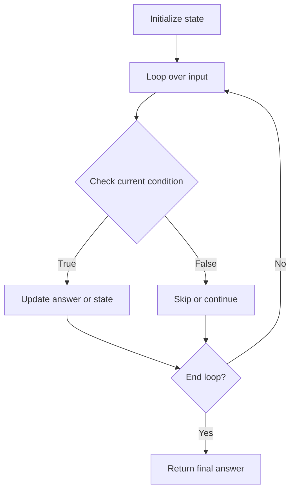

# Koko Eating Bananas

## Category
- Binary Search

## Problem Summary
Koko loves to eat bananas. There are n piles of bananas, the ith pile has piles[i] bananas. The guards have gone and will come back in h hours. Koko can decide her bananas-per-hour eating speed of k. Each hour, she chooses some pile of bananas and eats k bananas from that pile. If the pile has less than k bananas, she eats all of them instead and will not eat any more bananas during this hour. Koko likes to eat slowly but still wants to finish eating all the bananas before the guards return.

## Files
- solution.cpp

## Approach
Reduce the search space by checking the sorted property and moving the boundary toward the valid answer.

## Solution Trace
1. Find the sorted invariant that allows the answer to be narrowed efficiently.
2. Set the left and right boundaries based on the search condition.
3. Move only one pointer at a time while preserving the valid answer range.
4. Return the boundary value once the search condition is fully satisfied.

## Code Trace
1. `The implementation reads the input and transforms it into a compact state that matches the constraints of the problem.`
2. `The main loop checks the current item or node against the required condition before updating the answer.`
3. `Each branch and guard keeps the algorithm safe for edge cases and prevents redundant work.`
4. `After the scan completes, the collected state is returned as the final answer.`

## Code Walkthrough
- The implementation reads the input and transforms it into a compact state that matches the constraints of the problem.
- The main loop checks the current item or node against the required condition before updating the answer.
- Each branch and guard keeps the algorithm safe for edge cases and prevents redundant work.
- After the scan completes, the collected state is returned as the final answer.

## Mermaid Diagram

## Algorithm
1. Read the problem constraints and identify the correct state to track.
2. Choose the most fitting pattern for the data structure involved.
3. Process the collection or graph in a single pass where possible.
4. Maintain the answer and verify correctness against edge cases.
5. Return the final value or structure after the traversal is complete.

## Complexity Analysis
- Time Complexity: O(n) or O(n log n), depending on the exact operation pattern used in the solution.
- Space Complexity: O(n) or O(1) auxiliary space, based on the chosen data structure and recursion/stack usage.

## Core Intuition
The solution reduces the problem to a smaller, trackable state and then uses the correct structural pattern to process the input efficiently. This keeps the implementation both easy to follow and correct for the constraints.

## Edge Cases
- Empty input or single-element input
- Duplicate values or repeated edges
- Boundary values and extreme indices
- Already-sorted or reverse-sorted scenarios
- Cycles, null nodes, or disconnected components when relevant

## Folder
- 04-koko-eating-banana
