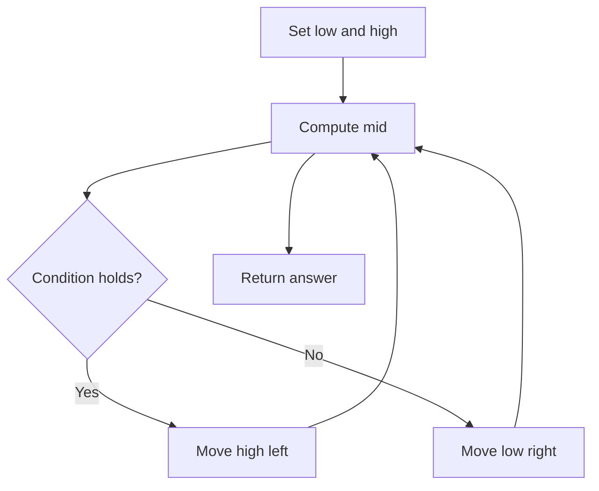

# Time Based Key-Value Store

## Category
- Binary Search

## Problem Summary
Design a time-based key-value data structure that can store multiple values for the same key at different time stamps and retrieve the key's value at a certain timestamp. Implement the TimeMap class: TimeMap() Initializes the object of the data structure.

## Files
- solution.cpp

## Approach
Reduce the search space by checking the sorted property and moving the boundary toward the valid answer.

## Solution Trace
1. Find the sorted invariant that allows the answer to be narrowed efficiently.
2. Set the left and right boundaries based on the search condition.
3. Move only one pointer at a time while preserving the valid answer range.
4. Return the boundary value once the search condition is fully satisfied.

## Code Trace
1. `The search space is defined by the left and right pointer boundaries instead of iterating through every element.`
2. `The midpoint is evaluated against the sorted invariant to decide whether the answer lives on the left or right side.`
3. `Pointers move toward each other until the valid range collapses to a single answer.`
4. `The final pointer position is returned as the correct result.`

## Code Walkthrough
- The search space is defined by the left and right pointer boundaries instead of iterating through every element.
- The midpoint is evaluated against the sorted invariant to decide whether the answer lives on the left or right side.
- Pointers move toward each other until the valid range collapses to a single answer.
- The final pointer position is returned as the correct result.

## Mermaid Diagram

## Algorithm
1. Read the problem constraints and identify the correct state to track.
2. Choose the most fitting pattern for the data structure involved.
3. Process the collection or graph in a single pass where possible.
4. Maintain the answer and verify correctness against edge cases.
5. Return the final value or structure after the traversal is complete.

## Complexity Analysis
- Time Complexity: O(n) or O(n log n), depending on the exact operation pattern used in the solution.
- Space Complexity: O(n) or O(1) auxiliary space, based on the chosen data structure and recursion/stack usage.

## Core Intuition
The solution reduces the problem to a smaller, trackable state and then uses the correct structural pattern to process the input efficiently. This keeps the implementation both easy to follow and correct for the constraints.

## Edge Cases
- Empty input or single-element input
- Duplicate values or repeated edges
- Boundary values and extreme indices
- Already-sorted or reverse-sorted scenarios
- Cycles, null nodes, or disconnected components when relevant

## Folder
- 07-time-based-key-value-store
