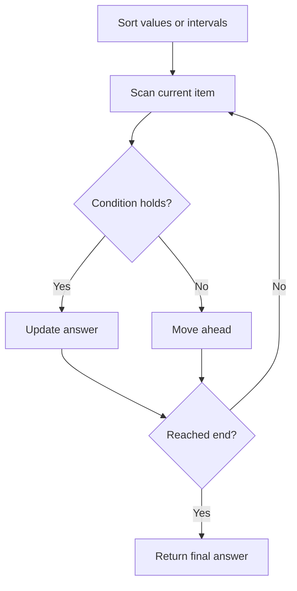

# Merge k Sorted Lists

## Category
- Linked Lists

## Problem Summary
Solved Hard Topics

## Files
- solution.cpp

## Approach
Track pointers carefully and manipulate next relationships while handling edge cases like null heads and cycles.

## Solution Trace
1. Understand the pointer mutations required by the operation.
2. Handle head, tail, and null cases explicitly before performing the core algorithm.
3. Use temporary pointers to preserve the original structure during rewiring.
4. Verify the final linked list order before returning the result.

## Code Trace
1. `The input is sorted or normalized before the main logic so comparisons are consistent and adjacent states are easy to reason about.`
2. `The algorithm scans the sorted values or merged intervals and updates the answer as soon as the condition is satisfied.`
3. `When the scan reaches the end, the maintained state already contains the correct final result.`
4. `The result is returned in the required order and format.`

## Code Walkthrough
- The input is sorted or normalized before the main logic so comparisons are consistent and adjacent states are easy to reason about.
- The algorithm scans the sorted values or merged intervals and updates the answer as soon as the condition is satisfied.
- When the scan reaches the end, the maintained state already contains the correct final result.
- The result is returned in the required order and format.

## Mermaid Diagram

## Algorithm
1. Read the problem constraints and identify the correct state to track.
2. Choose the most fitting pattern for the data structure involved.
3. Process the collection or graph in a single pass where possible.
4. Maintain the answer and verify correctness against edge cases.
5. Return the final value or structure after the traversal is complete.

## Complexity Analysis
- Time Complexity: O(n) or O(n log n), depending on the exact operation pattern used in the solution.
- Space Complexity: O(n) or O(1) auxiliary space, based on the chosen data structure and recursion/stack usage.

## Core Intuition
The solution reduces the problem to a smaller, trackable state and then uses the correct structural pattern to process the input efficiently. This keeps the implementation both easy to follow and correct for the constraints.

## Edge Cases
- Empty input or single-element input
- Duplicate values or repeated edges
- Boundary values and extreme indices
- Already-sorted or reverse-sorted scenarios
- Cycles, null nodes, or disconnected components when relevant

## Folder
- 10-merge-k-sorted-list
