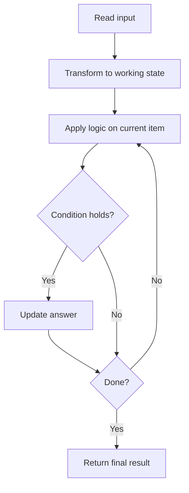

# Invert Tree

## Category
- Binary Tree

## Problem Summary
This problem was solved by translating the requirements into a clean algorithmic pattern and validating edge cases.

## Files
- solution.cpp

## Approach
Traverse the tree with DFS or BFS, carrying information through recursive or iterative state.

## Solution Trace
1. Choose a traversal order that matches the problem requirement: DFS for depth logic, BFS for level logic.
2. Pass along the relevant state while visiting each node.
3. Use recursion or an explicit stack to avoid losing context during traversal.
4. Merge child results back to the parent to form the final answer.

## Code Trace
1. `The implementation reads the input and transforms it into a compact state that matches the constraints of the problem.`
2. `The main loop checks the current item or node against the required condition before updating the answer.`
3. `Each branch and guard keeps the algorithm safe for edge cases and prevents redundant work.`
4. `After the scan completes, the collected state is returned as the final answer.`

## Code Walkthrough
- The implementation reads the input and transforms it into a compact state that matches the constraints of the problem.
- The main loop checks the current item or node against the required condition before updating the answer.
- Each branch and guard keeps the algorithm safe for edge cases and prevents redundant work.
- After the scan completes, the collected state is returned as the final answer.

## Mermaid Diagram

## Algorithm
1. Read the problem constraints and identify the correct state to track.
2. Choose the most fitting pattern for the data structure involved.
3. Process the collection or graph in a single pass where possible.
4. Maintain the answer and verify correctness against edge cases.
5. Return the final value or structure after the traversal is complete.

## Complexity Analysis
- Time Complexity: O(n) or O(n log n), depending on the exact operation pattern used in the solution.
- Space Complexity: O(n) or O(1) auxiliary space, based on the chosen data structure and recursion/stack usage.

## Core Intuition
The solution reduces the problem to a smaller, trackable state and then uses the correct structural pattern to process the input efficiently. This keeps the implementation both easy to follow and correct for the constraints.

## Edge Cases
- Empty input or single-element input
- Duplicate values or repeated edges
- Boundary values and extreme indices
- Already-sorted or reverse-sorted scenarios
- Cycles, null nodes, or disconnected components when relevant

## Folder
- 01-invert-tree
