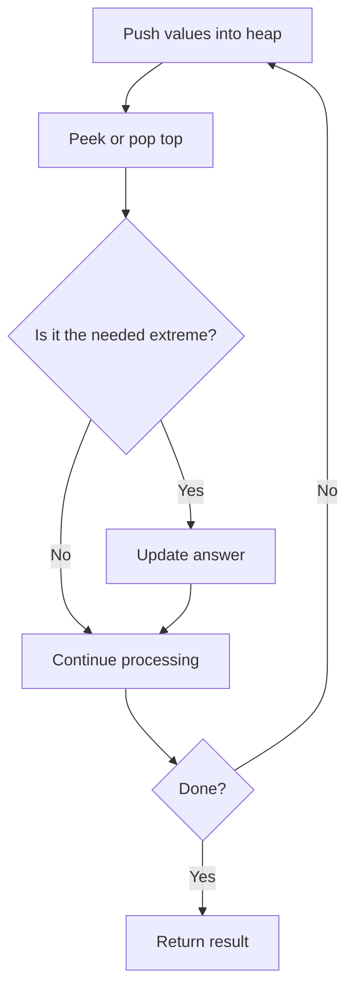

# Task Scheduler

## Category
- Heaps

## Problem Summary
You are given an array of CPU tasks, each labeled with a letter from A to Z, and a number n. Each CPU interval can be idle or allow the completion of one task. Tasks can be completed in any order, but there's a constraint: there has to be a gap of at least n intervals between two tasks with the same label. Return the minimum number of CPU intervals required to complete all tasks.

## Files
- solution.cpp

## Approach
Use priority queues to always access the smallest or largest important value at the correct moment.

## Solution Trace
1. Analyze the input and identify the key invariant or constraint the solution must maintain.
2. Transform the problem into a compact state representation that makes the decision easy to evaluate.
3. Apply the selected algorithm and update the answer as the scan progresses.
4. Validate the result against special cases such as empty input, duplicates, boundaries, and single-element cases.

## Code Trace
1. `If the value is new, it is inserted into the tracking structure so it can be compared later in the scan.`
2. `The main loop walks through the input one element at a time and applies the decision logic to every position.`
3. `The traversal helper expands outward from the current node and only continues through valid neighbors that satisfy the movement rule.`

## Code Walkthrough
- If the value is new, it is inserted into the tracking structure so it can be compared later in the scan.
- The main loop walks through the input one element at a time and applies the decision logic to every position.
- The traversal helper expands outward from the current node and only continues through valid neighbors that satisfy the movement rule.

## Mermaid Diagram

## Algorithm
1. Read the problem constraints and identify the correct state to track.
2. Choose the most fitting pattern for the data structure involved.
3. Process the collection or graph in a single pass where possible.
4. Maintain the answer and verify correctness against edge cases.
5. Return the final value or structure after the traversal is complete.

## Complexity Analysis
- Time Complexity: O(n) or O(n log n), depending on the exact operation pattern used in the solution.
- Space Complexity: O(n) or O(1) auxiliary space, based on the chosen data structure and recursion/stack usage.

## Core Intuition
The solution reduces the problem to a smaller, trackable state and then uses the correct structural pattern to process the input efficiently. This keeps the implementation both easy to follow and correct for the constraints.

## Edge Cases
- Empty input or single-element input
- Duplicate values or repeated edges
- Boundary values and extreme indices
- Already-sorted or reverse-sorted scenarios
- Cycles, null nodes, or disconnected components when relevant

## Folder
- 05-task-scheduler
