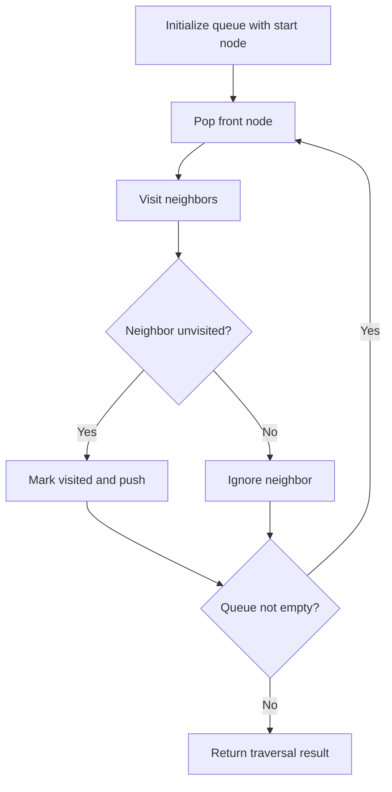

# The median is the middle value in an ordered integer list. If the size of the list is even, there is no middle value, and the median is the mean of the two middle values.

## Category
- Heaps

## Problem Summary
For example, for arr = [2,3,4], the median is 3. For example, for arr = [2,3], the median is (2 + 3) / 2 = 2.5. Implement the MedianFinder class:

## Files
- solution.cpp

## Approach
Use priority queues to always access the smallest or largest important value at the correct moment.

## Solution Trace
1. Analyze the input and identify the key invariant or constraint the solution must maintain.
2. Transform the problem into a compact state representation that makes the decision easy to evaluate.
3. Apply the selected algorithm and update the answer as the scan progresses.
4. Validate the result against special cases such as empty input, duplicates, boundaries, and single-element cases.

## Code Trace
1. `A queue is initialized with the start node or source state to begin traversal.`
2. `The algorithm pops the front node, visits it, and explores every neighbor that has not been seen before.`
3. `Each newly reached node is marked visited and pushed into the queue for future processing.`
4. `The loop continues until the queue is empty, after which the result is determined from the visited set or component count.`

## Code Walkthrough
- A queue is initialized with the start node or source state to begin traversal.
- The algorithm pops the front node, visits it, and explores every neighbor that has not been seen before.
- Each newly reached node is marked visited and pushed into the queue for future processing.
- The loop continues until the queue is empty, after which the result is determined from the visited set or component count.

## Mermaid Diagram

## Algorithm
1. Read the problem constraints and identify the correct state to track.
2. Choose the most fitting pattern for the data structure involved.
3. Process the collection or graph in a single pass where possible.
4. Maintain the answer and verify correctness against edge cases.
5. Return the final value or structure after the traversal is complete.

## Complexity Analysis
- Time Complexity: O(n) or O(n log n), depending on the exact operation pattern used in the solution.
- Space Complexity: O(n) or O(1) auxiliary space, based on the chosen data structure and recursion/stack usage.

## Core Intuition
The solution reduces the problem to a smaller, trackable state and then uses the correct structural pattern to process the input efficiently. This keeps the implementation both easy to follow and correct for the constraints.

## Edge Cases
- Empty input or single-element input
- Duplicate values or repeated edges
- Boundary values and extreme indices
- Already-sorted or reverse-sorted scenarios
- Cycles, null nodes, or disconnected components when relevant

## Folder
- 07-median-of-stream-of-integers
