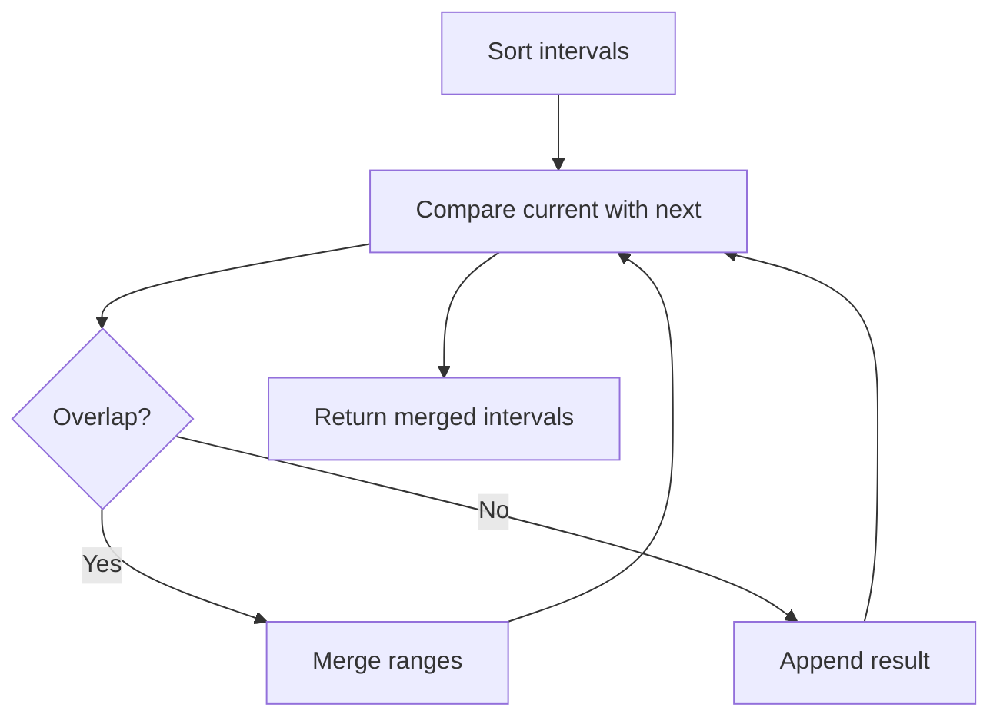

# Meeting Rooms II

## Category
- Intervals

## Problem Summary
Given two arrays start[] and end[] such that start[i] is the starting time of ith meeting and end[i] is the ending time of ith meeting. Return the minimum number of rooms required to attend all meetings. Note: A person can also attend a meeting if it's starting time is same as the previous meeting's ending time.

## Files
- solution.cpp

## Approach
Sort or merge intervals to keep overlapping ranges compact and easy to reason about.

## Solution Trace
1. Sort the intervals by start position to normalize the input order.
2. Merge overlapping or touching intervals using the current boundary state.
3. Carry forward any remaining non-overlapping pieces after the merge.
4. Return the final merged structure in the required output format.

## Code Trace
1. `The intervals are sorted so the merge logic always compares the current interval against the next valid range.`
2. `A running merged interval is updated whenever the current interval overlaps the active boundary.`
3. `Non-overlapping intervals are appended to preserve the final sorted output order.`
4. `The final merged vector is returned as the result.`

## Code Walkthrough
- The intervals are sorted so the merge logic always compares the current interval against the next valid range.
- A running merged interval is updated whenever the current interval overlaps the active boundary.
- Non-overlapping intervals are appended to preserve the final sorted output order.
- The final merged vector is returned as the result.

## Mermaid Diagram

## Algorithm
1. Read the problem constraints and identify the correct state to track.
2. Choose the most fitting pattern for the data structure involved.
3. Process the collection or graph in a single pass where possible.
4. Maintain the answer and verify correctness against edge cases.
5. Return the final value or structure after the traversal is complete.

## Complexity Analysis
- Time Complexity: O(n) or O(n log n), depending on the exact operation pattern used in the solution.
- Space Complexity: O(n) or O(1) auxiliary space, based on the chosen data structure and recursion/stack usage.

## Core Intuition
The solution reduces the problem to a smaller, trackable state and then uses the correct structural pattern to process the input efficiently. This keeps the implementation both easy to follow and correct for the constraints.

## Edge Cases
- Empty input or single-element input
- Duplicate values or repeated edges
- Boundary values and extreme indices
- Already-sorted or reverse-sorted scenarios
- Cycles, null nodes, or disconnected components when relevant

## Folder
- 05-meeting-rooms-ii
