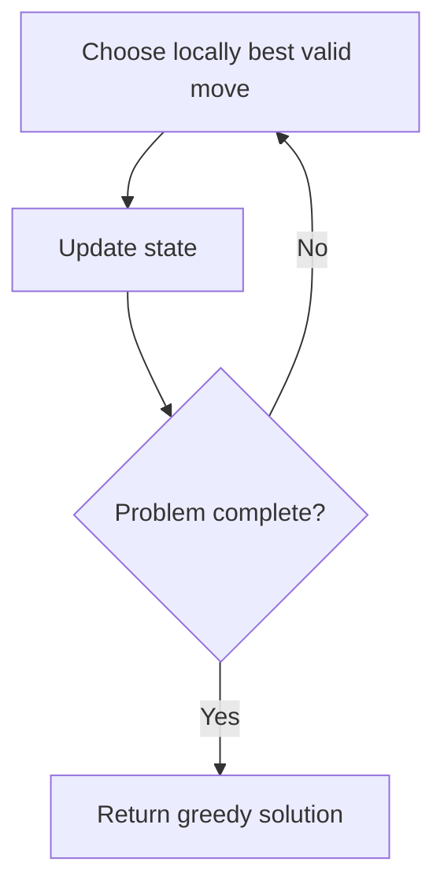

# Hand of Straights

## Category
- Greedy

## Problem Summary
Alice has some number of cards and she wants to rearrange the cards into groups so that each group is of size groupSize, and consists of groupSize consecutive cards. Given an integer array hand where hand[i] is the value written on the ith card and an integer groupSize, return true if she can rearrange the cards, or false otherwise.

## Files
- solution.cpp

## Approach
Choose the locally best valid action first while preserving correctness for the global solution.

## Solution Trace
1. Analyze the input and identify the key invariant or constraint the solution must maintain.
2. Transform the problem into a compact state representation that makes the decision easy to evaluate.
3. Apply the selected algorithm and update the answer as the scan progresses.
4. Validate the result against special cases such as empty input, duplicates, boundaries, and single-element cases.

## Code Trace
1. `The main loop walks through the input one element at a time and applies the decision logic to every position.`
2. `The function returns immediately when a duplicate is found, which keeps the solution efficient and avoids extra work.`

## Code Walkthrough
- The main loop walks through the input one element at a time and applies the decision logic to every position.
- The function returns immediately when a duplicate is found, which keeps the solution efficient and avoids extra work.

## Mermaid Diagram

## Algorithm
1. Read the problem constraints and identify the correct state to track.
2. Choose the most fitting pattern for the data structure involved.
3. Process the collection or graph in a single pass where possible.
4. Maintain the answer and verify correctness against edge cases.
5. Return the final value or structure after the traversal is complete.

## Complexity Analysis
- Time Complexity: O(n) or O(n log n), depending on the exact operation pattern used in the solution.
- Space Complexity: O(n) or O(1) auxiliary space, based on the chosen data structure and recursion/stack usage.

## Core Intuition
The solution reduces the problem to a smaller, trackable state and then uses the correct structural pattern to process the input efficiently. This keeps the implementation both easy to follow and correct for the constraints.

## Edge Cases
- Empty input or single-element input
- Duplicate values or repeated edges
- Boundary values and extreme indices
- Already-sorted or reverse-sorted scenarios
- Cycles, null nodes, or disconnected components when relevant

## Folder
- 04-hands-of-straight
