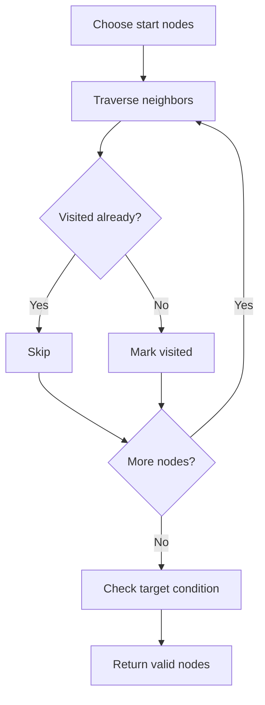

# Rotten Oranges

## Category
- Graph

## Problem Summary
Difficulty: MediumAccuracy: 46.02%Submissions: 238K+Points: 4Average Time: 20m Given a matrix mat[][], where each cell in the matrix can have values 0, 1 or 2 which has the following meaning: 0 : Empty cell

## Files
- solution.cpp

## Approach
Use graph traversal techniques such as DFS, BFS, or union-find to explore connectivity and reachability.

## Solution Trace
1. Identify the graph structure, whether it is a grid, adjacency list, or connectivity problem.
2. Choose DFS or BFS to propagate state across reachable nodes.
3. Mark visited cells or nodes to avoid revisiting and prevent cycles.
4. Check the target condition at the end of traversal and collect the valid results.

## Code Trace
1. `The ocean reachability matrices are initialized for the Pacific and Atlantic boundaries before the DFS begins.`
2. `Each DFS call expands only to neighbors whose height is greater than or equal to the current cell, which matches the flow rule from the problem statement.`
3. `A visited marker is set for each reached cell so the flood-fill does not revisit the same position unnecessarily.`
4. `The final output is built from the intersection of cells that can reach both oceans.`

## Code Walkthrough
- The ocean reachability matrices are initialized for the Pacific and Atlantic boundaries before the DFS begins.
- Each DFS call expands only to neighbors whose height is greater than or equal to the current cell, which matches the flow rule from the problem statement.
- A visited marker is set for each reached cell so the flood-fill does not revisit the same position unnecessarily.
- The final output is built from the intersection of cells that can reach both oceans.

## Mermaid Diagram

## Algorithm
1. Read the problem constraints and identify the correct state to track.
2. Choose the most fitting pattern for the data structure involved.
3. Process the collection or graph in a single pass where possible.
4. Maintain the answer and verify correctness against edge cases.
5. Return the final value or structure after the traversal is complete.

## Complexity Analysis
- Time Complexity: O(n) or O(n log n), depending on the exact operation pattern used in the solution.
- Space Complexity: O(n) or O(1) auxiliary space, based on the chosen data structure and recursion/stack usage.

## Core Intuition
The solution reduces the problem to a smaller, trackable state and then uses the correct structural pattern to process the input efficiently. This keeps the implementation both easy to follow and correct for the constraints.

## Edge Cases
- Empty input or single-element input
- Duplicate values or repeated edges
- Boundary values and extreme indices
- Already-sorted or reverse-sorted scenarios
- Cycles, null nodes, or disconnected components when relevant

## Folder
- 04-rotten-oranges
