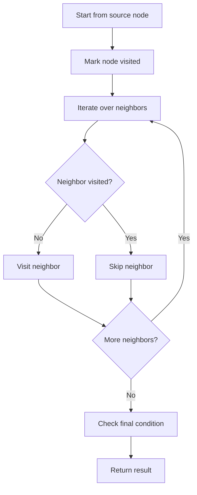

# Pacific Atlantic Water Flow

## Category
- Graph

## Problem Summary
There is an m x n rectangular island that borders both the Pacific Ocean and Atlantic Ocean. The Pacific Ocean touches the island's left and top edges, and the Atlantic Ocean touches the island's right and bottom edges. The island is partitioned into a grid of square cells. You are given an m x n integer matrix heights where heights[r][c] represents the height above sea level of the cell at coordinate (r, c). The island receives a lot of rain, and the rain water can flow to neighboring cells directly north, south, east, and west if the neighboring cell's height is less than or equal to the current cell's height. Water can flow from any cell adjacent to an ocean into the ocean.

## Files
- solution.cpp

## Approach
Use graph traversal techniques such as DFS, BFS, or union-find to explore connectivity and reachability.

## Solution Trace
1. Identify the graph structure, whether it is a grid, adjacency list, or connectivity problem.
2. Choose DFS or BFS to propagate state across reachable nodes.
3. Mark visited cells or nodes to avoid revisiting and prevent cycles.
4. Check the target condition at the end of traversal and collect the valid results.

## Code Trace
1. `The traversal starts from the relevant source or boundary node and marks it as visited.`
2. `Each recursive or iterative DFS step explores all valid neighbors before continuing deeper into the graph.`
3. `A visited array prevents cycles and repeated traversal of nodes already processed.`
4. `When all reachable nodes are explored, the solution checks whether the final condition is satisfied and returns the result.`

## Code Walkthrough
- The traversal starts from the relevant source or boundary node and marks it as visited.
- Each recursive or iterative DFS step explores all valid neighbors before continuing deeper into the graph.
- A visited array prevents cycles and repeated traversal of nodes already processed.
- When all reachable nodes are explored, the solution checks whether the final condition is satisfied and returns the result.

## Mermaid Diagram

## Algorithm
1. Read the problem constraints and identify the correct state to track.
2. Choose the most fitting pattern for the data structure involved.
3. Process the collection or graph in a single pass where possible.
4. Maintain the answer and verify correctness against edge cases.
5. Return the final value or structure after the traversal is complete.

## Complexity Analysis
- Time Complexity: O(n) or O(n log n), depending on the exact operation pattern used in the solution.
- Space Complexity: O(n) or O(1) auxiliary space, based on the chosen data structure and recursion/stack usage.

## Core Intuition
The solution reduces the problem to a smaller, trackable state and then uses the correct structural pattern to process the input efficiently. This keeps the implementation both easy to follow and correct for the constraints.

## Edge Cases
- Empty input or single-element input
- Duplicate values or repeated edges
- Boundary values and extreme indices
- Already-sorted or reverse-sorted scenarios
- Cycles, null nodes, or disconnected components when relevant

## Folder
- 05-pacific-atlantic-ocean-water-flow
