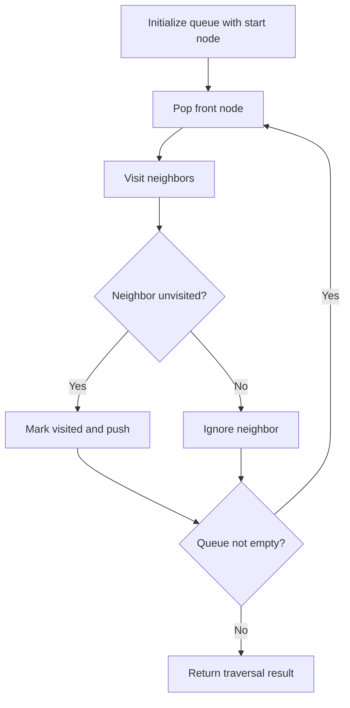

# Course Schedule II

## Category
- Graph

## Problem Summary
There are a total of numCourses courses you have to take, labeled from 0 to numCourses - 1. You are given an array prerequisites where prerequisites[i] = [ai, bi] indicates that you must take course bi first if you want to take course ai. For example, the pair [0, 1], indicates that to take course 0 you have to first take course 1. Return the ordering of courses you should take to finish all courses. If there are many valid answers, return any of them. If it is impossible to finish all courses, return an empty array.

## Files
- solution.cpp

## Approach
Use graph traversal techniques such as DFS, BFS, or union-find to explore connectivity and reachability.

## Solution Trace
1. Identify the graph structure, whether it is a grid, adjacency list, or connectivity problem.
2. Choose DFS or BFS to propagate state across reachable nodes.
3. Mark visited cells or nodes to avoid revisiting and prevent cycles.
4. Check the target condition at the end of traversal and collect the valid results.

## Code Trace
1. `A queue is initialized with the start node or source state to begin traversal.`
2. `The algorithm pops the front node, visits it, and explores every neighbor that has not been seen before.`
3. `Each newly reached node is marked visited and pushed into the queue for future processing.`
4. `The loop continues until the queue is empty, after which the result is determined from the visited set or component count.`

## Code Walkthrough
- A queue is initialized with the start node or source state to begin traversal.
- The algorithm pops the front node, visits it, and explores every neighbor that has not been seen before.
- Each newly reached node is marked visited and pushed into the queue for future processing.
- The loop continues until the queue is empty, after which the result is determined from the visited set or component count.

## Mermaid Diagram

## Algorithm
1. Read the problem constraints and identify the correct state to track.
2. Choose the most fitting pattern for the data structure involved.
3. Process the collection or graph in a single pass where possible.
4. Maintain the answer and verify correctness against edge cases.
5. Return the final value or structure after the traversal is complete.

## Complexity Analysis
- Time Complexity: O(n) or O(n log n), depending on the exact operation pattern used in the solution.
- Space Complexity: O(n) or O(1) auxiliary space, based on the chosen data structure and recursion/stack usage.

## Core Intuition
The solution reduces the problem to a smaller, trackable state and then uses the correct structural pattern to process the input efficiently. This keeps the implementation both easy to follow and correct for the constraints.

## Edge Cases
- Empty input or single-element input
- Duplicate values or repeated edges
- Boundary values and extreme indices
- Already-sorted or reverse-sorted scenarios
- Cycles, null nodes, or disconnected components when relevant

## Folder
- 08-course-schedule-ii
