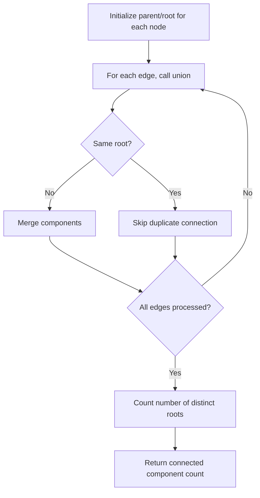

# Is Graph A Tree

## Category
- Graph

## Problem Summary
This problem was solved by translating the requirements into a clean algorithmic pattern and validating edge cases.

## Files
- solution.cpp

## Approach
Use graph traversal techniques such as DFS, BFS, or union-find to explore connectivity and reachability.

## Solution Trace
1. Identify the graph structure, whether it is a grid, adjacency list, or connectivity problem.
2. Choose DFS or BFS to propagate state across reachable nodes.
3. Mark visited cells or nodes to avoid revisiting and prevent cycles.
4. Check the target condition at the end of traversal and collect the valid results.

## Code Trace
1. `Each node starts as its own parent or root in the disjoint-set structure.`
2. `For every edge, the code merges the two endpoints into the same connected component with union/find.`
3. `The root representative for each node determines whether two vertices are connected.`
4. `The final answer is the count of distinct roots left after all unions are processed.`

## Code Walkthrough
- Each node starts as its own parent or root in the disjoint-set structure.
- For every edge, the code merges the two endpoints into the same connected component with union/find.
- The root representative for each node determines whether two vertices are connected.
- The final answer is the count of distinct roots left after all unions are processed.

## Mermaid Diagram

## Algorithm
1. Read the problem constraints and identify the correct state to track.
2. Choose the most fitting pattern for the data structure involved.
3. Process the collection or graph in a single pass where possible.
4. Maintain the answer and verify correctness against edge cases.
5. Return the final value or structure after the traversal is complete.

## Complexity Analysis
- Time Complexity: O(n) or O(n log n), depending on the exact operation pattern used in the solution.
- Space Complexity: O(n) or O(1) auxiliary space, based on the chosen data structure and recursion/stack usage.

## Core Intuition
The solution reduces the problem to a smaller, trackable state and then uses the correct structural pattern to process the input efficiently. This keeps the implementation both easy to follow and correct for the constraints.

## Edge Cases
- Empty input or single-element input
- Duplicate values or repeated edges
- Boundary values and extreme indices
- Already-sorted or reverse-sorted scenarios
- Cycles, null nodes, or disconnected components when relevant

## Folder
- 09-is-graph-a-tree
