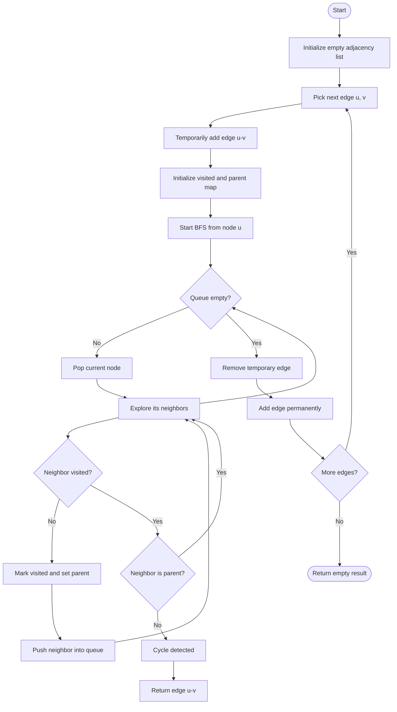
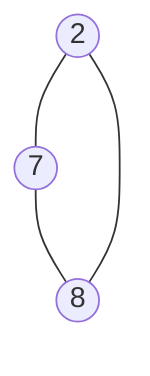

# Redundant Connection – BFS (Cycle Detection)

## Problem Statement

You are given a graph that started as a tree with `n` nodes (labeled from `1` to `n`) and one additional edge was added.

The added edge connects two different vertices and creates a cycle.

Return the edge that can be removed so that the resulting graph becomes a tree.

If multiple answers exist, return the edge that appears last in the input.

## Approach: BFS + Parent Tracking

We process the edges one by one and maintain an adjacency list.

For every edge `(u, v)`:

1. Temporarily add the edge to the adjacency list.
2. Perform BFS starting from node `u`.
3. During BFS, maintain a mapping of each node to its parent.
4. If we encounter an already visited neighbor that is not the current node's parent, a cycle exists.
5. If a cycle exists, return the current edge.
6. Otherwise, remove the temporary edge and add it permanently.

### Why Parent Tracking?

In an undirected graph, every edge is bidirectional.

For example:

```text
1 ---- 2
```

When BFS visits node `1`, it visits node `2`.

When BFS reaches node `2`, it encounters node `1` again. This is not a cycle because node `1` is its parent.

However, if node `2` encounters another visited node that is not its parent, a cycle exists.

## Mermaid Flowchart



## Mermaid Example: Cycle Detection

Consider the following edges:

```text
[2,7], [7,8], [2,8]
```

After adding the third edge, the graph becomes:



The cycle is:

```text
2 → 7 → 8 → 2
```

When processing edge `[2,8]`, BFS detects that node `8` is already visited and is not the parent of node `2`.

Therefore, `[2,8]` is the redundant connection.

## C++ Implementation

```cpp
class Solution {
public:
    bool isCycleExist(vector<int> adj[], vector<int>& visited, int node) {
        map<int, int> childToParentMapping;
        queue<int> q;

        q.push(node);
        childToParentMapping[node] = -1;
        visited[node] = 1;

        while (!q.empty()) {
            int top = q.front();
            q.pop();

            for (auto ngbr : adj[top]) {
                if (!visited[ngbr]) {
                    visited[ngbr] = 1;
                    q.push(ngbr);
                    childToParentMapping[ngbr] = top;
                }
                else if (childToParentMapping[top] != ngbr) {
                    return true;
                }
            }
        }

        return false;
    }

    bool checkCycleIfAdded(int u, int v, vector<int> adjList[], int n) {
        adjList[u].push_back(v);
        adjList[v].push_back(u);

        vector<int> vis(n + 1, 0);

        if (isCycleExist(adjList, vis, u)) {
            return true;
        }

        adjList[u].pop_back();
        adjList[v].pop_back();

        return false;
    }

    vector<int> findRedundantConnection(vector<vector<int>>& edges) {
        int n = edges.size();
        vector<int> adjList[n + 1];

        for (auto edge : edges) {
            int u = edge[0];
            int v = edge[1];

            if (checkCycleIfAdded(u, v, adjList, n)) {
                return {u, v};
            }
            else {
                adjList[u].push_back(v);
                adjList[v].push_back(u);
            }
        }

        return {};
    }
};
```

## Complexity Analysis

Let:

* `V` = Number of vertices
* `E` = Number of edges

| Operation            | Complexity     |
| -------------------- | -------------- |
| Adding an edge       | O(1)           |
| BFS traversal        | O(V + E)       |
| Processing all edges | O(E × (V + E)) |
| Visited array        | O(V)           |
| Parent mapping       | O(V)           |
| Adjacency list       | O(V + E)       |

**Time Complexity:** `O(E × (V + E))`

**Space Complexity:** `O(V + E)`

## Important Observations

* In an undirected graph, always track the parent during BFS cycle detection.
* A visited neighbor does not necessarily indicate a cycle; it must not be the current node's parent.
* Start BFS from `u`, not always from node `1`, because the graph may have disconnected components before all edges are processed.
* Temporarily adding and removing an edge allows us to check whether that particular edge creates a cycle.
* The first edge that creates a cycle is the redundant connection because edges are processed in input order.
